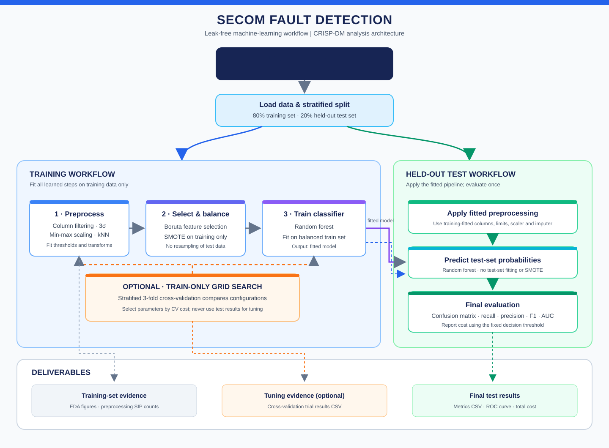

# SECOM Case Study – Project Plan (7 weeks + wrap-up)

Method: CRISP-DM (cyclical). Pipeline: **Split → Preprocessing → Feature selection → Balancing → Training → Evaluation.**
Golden rules: split first · learn on train only · no mean imputation · 3σ (not IQR) · SMOTE/ROSE on train only · judge by test cost/sensitivity, not accuracy · log everything in SIP.

| Week | CRISP-DM | Tasks | Script function | Notebook / evidence | Done |
|---|---|---|---|---|---|
| 1 | Business & data understanding | Read both papers, set up environment, download data, descriptive stats | `load_secom` | Entries on papers, wafer Q&A (6 questions) | ☐ |
| 2 | Data understanding / preparation | Class balance, flag NaNs, stratified 80/20 split, constant/duplicate/NaN columns, NaN histogram + Pareto, correlation heatmap (no removal), 3σ outliers | `train_test_split`, `Preprocessor`, `eda_figures` | SIP rows 1–4, 2 NaN diagrams, heatmap | ☐ |
| 3 | Data preparation / modelling | Re-flag NaNs, imputation theory (why not mean), kNN k=5 with scaling, first random forest (training accuracy only!) | `Preprocessor` | SIP row 5, imputation pros/cons | ☐ |
| 4 | Modelling | Feature reduction vs selection, Boruta (shadow features), 15–20 features, SMOTE/ROSE, confusion matrix, Type I/II, metrics theory | `run_pipeline` | SIP rows 6–7, metrics definitions | ☐ |
| 5 | Modelling / evaluation | Normality check (skip for RF), min-max scaling, retrain, train vs test error, apply identical pipeline to test set, process map | `Preprocessor.transform` | Process map, test confusion matrix | ☐ |
| 6 | Evaluation | Compare balancing methods, grid search, trial log, visualisation, cost-based optimisation | `grid_search`, `total_cost` | Trial table, cost curves | ☐ |
| 7 | Evaluation | Final pipeline diagram, test-set metrics (recall, precision, F1, AUC), total cost | `metrics` | Final results chapter | ☐ |
| Wrap-up | Deployment (not required) | Lock test set, big-picture diagram, finalize SIP, sync script/notebook/slides, send script + PDF | – | Presentation (MPMD template) | ☐ |

## Architecture diagram

The analysis script follows the architecture below. The color-coded lanes distinguish training from held-out test work; optional cross-validation and the main output files are also shown. Preprocessing, feature selection, resampling, and model fitting use training data only.



Editable diagram source: [assets/secom_architecture.svg](assets/secom_architecture.svg).

### Main components

| Component | Responsibility |
|---|---|
| Data loader | Loads the sensor readings, labels, and timestamps from UCI or a local data directory. |
| Split and EDA | Creates the stratified holdout split and produces training-set exploratory figures. |
| Preprocessor | Learns column filtering, 3-sigma limits, min-max scaling, and kNN imputation from training data; applies those fitted steps unchanged to test data. |
| Feature selection and balancing | Fits Boruta on training data and applies SMOTE only to the selected training features. |
| Model and tuning | Fits the random forest; optional grid search compares configurations using training-set cross-validation. |
| Evaluation and outputs | Evaluates the final model once on the held-out test set and saves metrics, ROC, grid-search results, and SIP counts. |

## Repository layout
```
secom-case-study/
├── data/            (runtime cache, not submitted)
├── src/secom_analysis.py
├── notebooks/scientific_diary.md   → copy into Google Docs template
├── docs/project_plan.md
└── results/{figures,tables}
```

## Test-set integrity checklist (tick before submission)
- [ ] Split is the first operation after loading
- [ ] Thresholds, 3σ limits, scaler, imputer, Boruta selection fitted on train only
- [ ] SMOTE/ROSE never applied to test data
- [ ] No hyper-parameter chosen by looking at test results (grid search uses CV on train)
- [ ] Test metrics reported once, after the final model is fixed

## Ideas for the "better than the papers" argument
- Leak-free evaluation with stratified test set (papers: selection before split, non-stratified test).
- Report uncertainty: repeated stratified CV; with ~21 fails in test, single-split metrics are noisy.
- Threshold tuning on out-of-fold predictions to minimise cost (not fixed 0.5).
- Compare SMOTE vs ROSE vs class weights; compare Boruta vs MeanDiff (paper 2).
- Optional: time-aware check (labels are timestamped, 19 Jul – 17 Oct 2008) to test temporal drift.

## Known deviations to explain
- After rough reduction 450 columns vs ≈ 470 expected in the manual; Boruta (quick run) 10 vs 15–20 expected. Re-check in full run.
